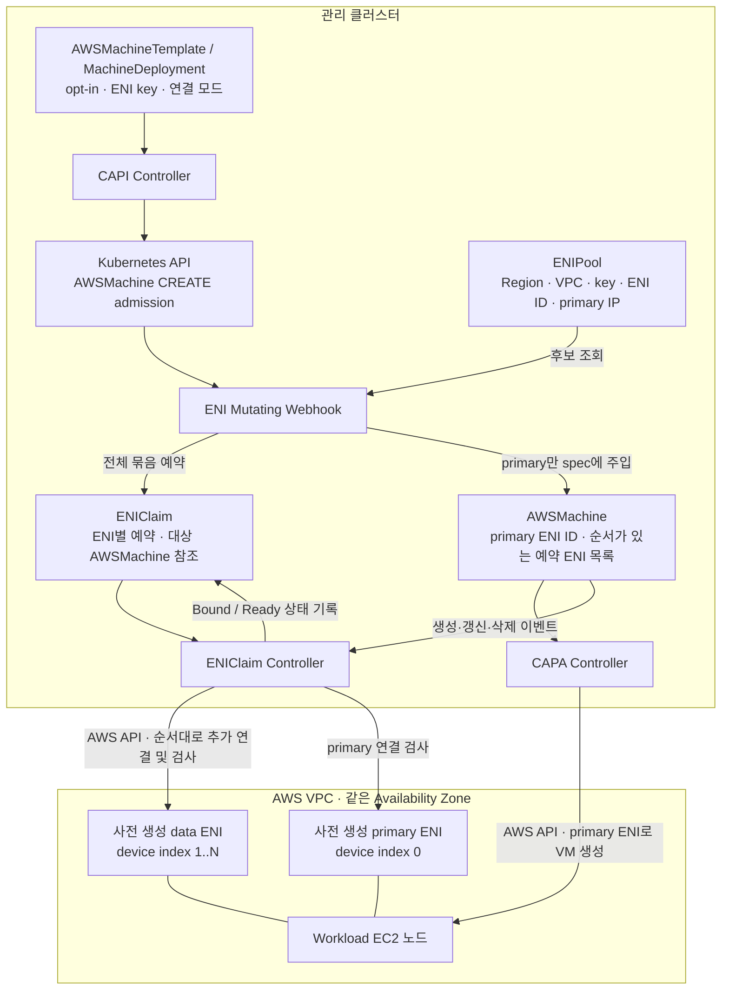
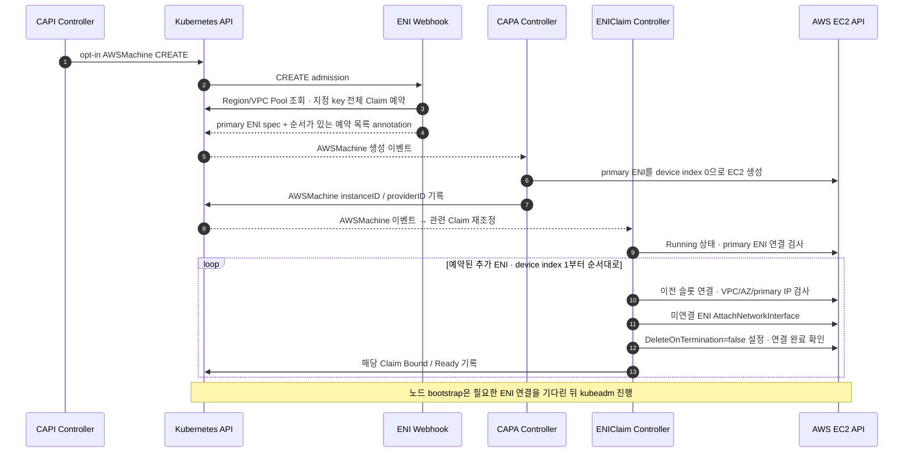

# CAPA ENI Controller

CAPA ENI Controller는 Cluster API Provider AWS(CAPA)가 생성하는 EC2 노드에
사전에 준비된 Elastic Network Interface(ENI)를 선택적으로 할당하는 Kubernetes
확장 컨트롤러입니다.

일반적인 `AWSMachineTemplate` 기반 흐름을 유지하면서, opt-in annotation이 있는
템플릿에서 생성된 `AWSMachine`에만 ENI Pool을 적용합니다. 사용할 수 있는 ENI가
없으면 `AWSMachine.spec.networkInterfaces`를 비워 두어 CAPA와 AWS의 기본 동적
private IP 할당 방식으로 진행합니다.

## 목표

- `AWSMachineTemplate`과 `MachineDeployment`의 표준 생성 흐름 유지
- 사람이 등록한 ENI 목록을 Region 및 VPC 단위 Pool로 관리
- 각 `AWSMachine`에 서로 다른 ENI를 안전하게 할당
- MachineDeployment별 key annotation으로 특정 ENI 선택
- Pool 고갈 시 CAPA 기본 네트워크 할당으로 자동 fallback
- Machine 삭제 및 재생성 과정에서 ENI 할당 상태를 일관되게 관리

## Opt-in 사용법

annotation은 `AWSMachineTemplate.metadata`가 아니라 복제 대상인
`spec.template.metadata`에 설정해야 합니다.

```yaml
apiVersion: infrastructure.cluster.x-k8s.io/v1beta2
kind: AWSMachineTemplate
metadata:
  name: worker
  namespace: workload-cluster
spec:
  template:
    metadata:
      annotations:
        eni.dcn.ssu.ac.kr/allocate-from-pool: "true"
    spec:
      instanceType: m5.large
```

annotation이 없는 템플릿에서 생성된 `AWSMachine`은 Webhook과 allocator의
처리 대상이 아니며 기존 CAPA 방식으로 생성됩니다.

특정 ENI가 필요하면 Pool interface의 `key`와 같은 값을
`MachineDeployment.spec.template.metadata.annotations`에 지정합니다. 이 annotation은
CAPI가 생성하는 `Machine`으로 전파되고 allocator가 소유 Machine에서 읽습니다.

```yaml
apiVersion: cluster.x-k8s.io/v1beta2
kind: MachineDeployment
spec:
  template:
    metadata:
      annotations:
        eni.dcn.ssu.ac.kr/interface-key: edge-worker-1
```

같은 annotation을 `AWSMachineTemplate.spec.template.metadata.annotations`에 직접
설정해도 동작하며, AWSMachine 쪽 값이 Machine 쪽 값보다 우선합니다. key annotation이
없으면 기존처럼 사용 가능한 ENI 중 private IPv4가 가장 작은 항목을 선택합니다.

## ENI Pool 예시

사용자는 Pool의 Region, VPC ID, ENI ID와 각 ENI의 primary private IPv4를
입력합니다. AZ 및 subnet은 입력하지 않습니다.

```yaml
apiVersion: networking.dcn.ssu.ac.kr/v1alpha1
kind: ENIPool
metadata:
  name: prod-ap-northeast-2
spec:
  region: ap-northeast-2
  vpcID: vpc-0123456789abcdef0
  exhaustionPolicy: Dynamic
  interfaces:
    - key: core-worker-1
      id: eni-00000000000000001
      privateIP: 10.20.1.25
    - key: edge-worker-1
      id: eni-00000000000000002
      privateIP: 10.20.1.26
```

기본 할당 모드는 AWS API를 호출하지 않는 trust mode입니다. 사용자가 선언한
ENI ID, VPC와 primary private IPv4를 기준으로 Claim이 없는 ENI를 선택합니다.
`attach-additional-interfaces: "true"` 모드에서는 이후 AWS API로 실제 연결을
검사하고 추가 ENI를 연결합니다. 할당 가능한 ENI는 private IPv4의 숫자값이 작은
순서로 선택됩니다. AZ와 subnet은 입력하지 않으며, 선택된 ENI가 가진 네트워크
속성에 맞춰 CAPA와 EC2가 생성을 진행합니다.

`key`는 Pool 안에서 유일해야 합니다. 요청한 key가 Pool에 없으면 AWSMachine CREATE를
허용하지 않아 오타로 인해 다른 ENI나 동적 IP가 배정되는 것을 방지합니다. 요청한
ENI가 이미 Claim된 경우에는 Pool의 `exhaustionPolicy`가 적용됩니다.

## 동작 구조 및 토폴로지

컨트롤러와 CR은 관리 클러스터에 있습니다. EC2 노드에는 컨트롤러를 설치하지
않으며, 관리 클러스터의 CAPA와 ENI controller가 AWS API를 호출합니다.
아래 그림은 `attach-additional-interfaces: "true"`인 고정 다중 ENI 구성입니다.



| 구성요소 | 역할 |
| --- | --- |
| AWSMachineTemplate annotation | 사용할 primary key, 추가 key 순서, 추가 연결 모드 지정. CAPI가 생성하는 AWSMachine에 복사. |
| ENIPool | 사전에 생성한 ENI의 key·ID·primary IP 등록. ENI와 secondary IP 생성은 사전 준비 단계에서 수행. |
| Mutating Webhook | AWSMachine CREATE 때 Claim을 원자적으로 예약. 추가 연결 모드에서는 primary만 `spec.networkInterfaces`에 기록. |
| CAPA Controller | primary ENI를 사용해 EC2 생성. 생성된 AWSMachine의 spec을 나중에 바꾸지 않음. |
| ENIClaim Controller | AWSMachine의 `instanceID` 또는 `providerID`로 대상 EC2 식별. 예약 목록의 순서를 device index로 사용해 추가 ENI 연결. |
| AWS 연결 검사 | VPC·AZ·primary IP·대상 EC2·device index 검사. 다른 VM 또는 슬롯의 연결을 강제로 빼앗지 않음. |

### 생성 및 추가 연결 시퀀스



`reserved-interface-set` annotation에는 primary부터 추가 ENI까지의 **ENI ID**가
저장됩니다. Claim의 `spec.machineRef`는 대상 AWSMachine의 namespace와 name을
가리킵니다. 따라서 VM 이름 추측이나 IP 검색으로 연결 대상을 고르지 않습니다.
이미 올바르게 연결된 ENI는 재사용하며, 연결 대기 중에는 재조정합니다.
AWSMachine 삭제 후 Claim을 회수하지만, 이 컨트롤러는 ENI를 detach하거나 삭제하지
않습니다. `DeleteOnTermination=false`로 ENI와 기존 IP 할당을 보존합니다.

추가 연결 annotation을 생략하면 예약한 전체 ENI 목록을 CAPA에 전달하는 기존
방식입니다. 단일 ENI의 Pool 고갈은 `exhaustionPolicy`에 따르지만, 고정 다중 ENI
묶음의 예약 실패는 admission을 거부하며 동적 IP로 전환하지 않습니다.

기본 할당 흐름의 트리거 조건과 대표 operation은
[`docs/operation-flow.md`](docs/operation-flow.md), API와 설계 원칙은
[`docs/design.md`](docs/design.md)를 참조하십시오.

## 현재 상태

CRD, CREATE admission 기반 Claim allocator, Pool inventory, 동적 fallback 및 ENI
회수 로직을 포함합니다. CAPA v2.13 환경에서 사전 생성 ENI가 worker EC2의 primary
interface로 연결되고, Pool 선언 IP와 Machine `InternalIP`가 일치하는 것을
검증했습니다.

## 개발 및 설치

필수 조건은 Go 1.26 이상, Docker, `kubectl`, Kustomize 및 cert-manager입니다.

```bash
make manifests generate test
make docker-build docker-push IMG=<registry>/capa-eni-controller:<tag>
make deploy IMG=<registry>/capa-eni-controller:<tag>
kubectl apply -f config/samples/networking_v1alpha1_enipool.yaml
```

Webhook 인증서는 Kubebuilder 기본 구성에 따라 cert-manager가 발급합니다.
기본 trust mode의 allocator에는 AWS IAM 자격 증명이 필요하지 않습니다.
추가 ENI 연결 모드에는 ENI controller의 AWS 자격 증명과 아래에 설명한 EC2
권한이 필요합니다. CAPA의 EC2 생성 권한은 별도로 유지합니다.

`package/` 디렉터리는 렌더링된 설치 YAML과 `Kptfile`을 포함하는 KPT 패키지입니다.
실제 workload
cluster용 CAPI 리소스는 별도 KPT 패키지에서 관리하고, opt-in하려는
`AWSMachineTemplate.spec.template.metadata.annotations`에 위 annotation을
추가하십시오.

## License

This project is licensed under the Apache License, Version 2.0. See
[`LICENSE`](LICENSE) for the full license text.

## 고정 다중 ENI 묶음

`interface-key`는 primary ENI를 지정한다. `additional-interface-keys`는 그 뒤에
연결할 ENI의 key를 쉼표로 나열한다. 아래는 Edge worker의 연결 순서다.

```yaml
spec:
  template:
    metadata:
      annotations:
        eni.dcn.ssu.ac.kr/allocate-from-pool: "true"
        eni.dcn.ssu.ac.kr/interface-key: edge_primary_eni
        eni.dcn.ssu.ac.kr/additional-interface-keys: edge_n2_eni,edge_n4_eni,edge_n3_eni,edge_n6_eni
```

- ENIPool에 다섯 ENI를 각각 등록한다. 순서는 primary → N2 → N4 → N3 → N6이다. 기본 모드는 전체를 CAPA에 전달하고, 추가 연결 모드는 primary만 CAPA에 전달한 뒤 컨트롤러가 나머지를 연결한다.
- 모든 ENI를 예약한 경우에만 AWSMachine을 허용한다. 중간 예약에 실패하면 그 요청에서 새로 만든 Claim을 해제한다.
- 동일 admission 요청의 재진입은 자기 Claim을 재사용한다. 서로 다른 admission 요청은 같은 Machine 이름이라도 Claim을 공유하지 않는다. 실패한 생성 요청의 잔여 Claim은 기존 30초 유예 후 회수된다.
- 누락·중복 key, 다른 Machine이 예약한 ENI는 거부한다. 다중 ENI 묶음은 동적 네트워크로 전환하지 않는다.
- ENI와 primary·secondary IP는 AWS에 미리 준비한다. 컨트롤러는 IP를 새로 할당하거나 ENI를 생성하지 않는다.
- ENI들은 같은 VPC·AZ에 있어야 한다. 주소·subnet·사용 가능 상태는 설치 전 AWS 조회로 확인한다.
- 고정 ENI를 재사용하는 MachineDeployment는 `maxSurge: 0`, `maxUnavailable: 1`을 사용한다.

### 로컬 바이너리 이미지

```bash
build_dir=$(mktemp -d)
CGO_ENABLED=0 GOOS=linux GOARCH=amd64 go build -trimpath -ldflags='-s -w' -o "$build_dir/manager" cmd/main.go
cp /etc/ssl/certs/ca-certificates.crt "$build_dir/ca-certificates.crt"
revision=$(git rev-parse HEAD)
docker build -f Dockerfile.binary --label "org.opencontainers.image.revision=$revision" -t "localhost/capa-eni-controller:source-${revision:0:12}" "$build_dir"
```

이 경로는 소스가 없는 정적 바이너리 이미지를 만든다. Registry로 전송하지 않는다.
공개 릴리스 `v0.2.0`은 단일 ENI용이므로 이 묶음 설정에 사용하지 않는다.

## CAPA API compatibility and additional interfaces

The allocator discovers served versions independently for `AWSMachine`, `AWSCluster`, CAPI `Machine` and `Cluster`. It prefers `v1beta2` and accepts `v1beta1` when that is the served contract. The admission endpoint handles both AWSMachine versions. Provider fields outside the allocator's metadata and ENI changes are preserved; upgrading CAPA is not required for these contracts.

For CAPA CRDs that limit `spec.networkInterfaces`, opt in to controller-managed data interfaces on the worker AWSMachineTemplate:

```yaml
spec:
  template:
    metadata:
      annotations:
        eni.dcn.ssu.ac.kr/allocate-from-pool: "true"
        eni.dcn.ssu.ac.kr/interface-key: primary
        eni.dcn.ssu.ac.kr/additional-interface-keys: n2,n4,n3,n6
        eni.dcn.ssu.ac.kr/attach-additional-interfaces: "true"
```

The keys reference ENIPool entries. Admission reserves the full set, writes only the primary ID to `spec.networkInterfaces`, and records the ordered IDs in `eni.dcn.ssu.ac.kr/reserved-interface-set`. CAPA creates the instance with the primary ENI. The ENIClaim reconciler obtains its EC2 instance ID from AWSMachine and attaches data ENIs at device indexes 1 onward. Earlier indexes must be attached before the next index is connected. Instance/ENI VPC, AZ, primary IP and occupied slots are checked. Existing attachments are reused, never detached or taken over. `DeleteOnTermination=false` preserves the ENIs and their IP assignments for replacement nodes.

The node bootstrap must wait for the expected ENI IDs and device indexes before kubeadm. With the annotation absent, existing complete-list allocation behavior is retained.

The controller uses the standard AWS SDK credential chain. An optional `eni-controller-aws` Secret can supply `AWS_ACCESS_KEY_ID`, `AWS_SECRET_ACCESS_KEY`, `AWS_SESSION_TOKEN` and `AWS_REGION`; Pod IAM credentials can be used instead. Required AWS actions are `ec2:DescribeInstances`, `ec2:DescribeNetworkInterfaces`, `ec2:AttachNetworkInterface` and `ec2:ModifyNetworkInterfaceAttribute`. Scope mutations to the managed ENIs and instance boundary.

Validation includes legacy-only API-server envtest, mixed CAPI/CAPA API selection, both admission wire versions, partial reservation rollback, and attachment idempotency and conflict rejection.
